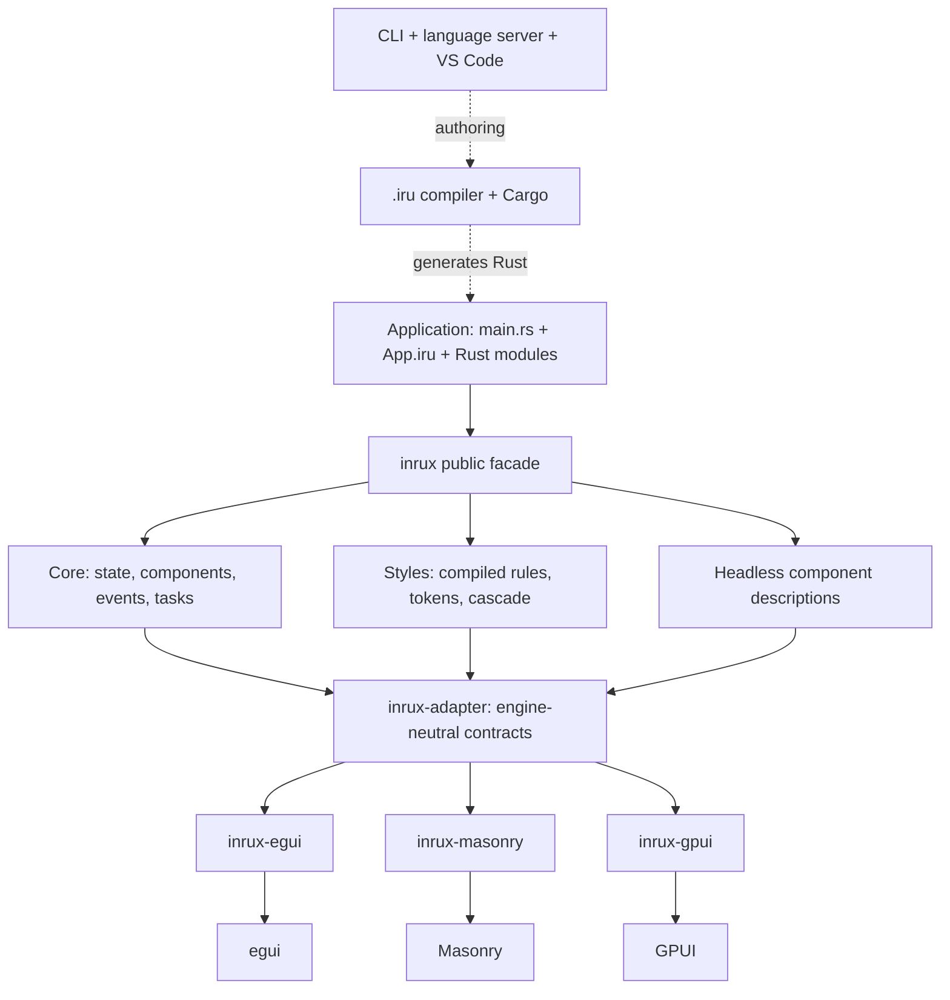

<picture>
  <source media="(prefers-color-scheme: dark)" srcset="assets/brand/inrux-lockup-dark.svg">
  
</picture>

# Inrux

An experimental native GUI framework for Rust, with `.iru` single-file components, reactive state, reusable components and compiled CSS-like styling.

**Early alpha.** APIs and file syntax can change. This is a working prototype for community feedback, not a production-ready framework. [Current support and limitations](docs/STATUS.md) describe what works today.

Inrux stands for **Igris Native Rust UI eXperience**. Application logic is Rust; `main.rs` mounts `App.iru`. Ordinary Rust modules and Cargo libraries work inside component logic. No browser or webview is required by the three current backends.

## Try the playgrounds

Install a current stable Rust toolchain and your platform's [native build prerequisites](docs/GETTING-STARTED.md#requirements), then:

```sh
git clone https://github.com/igris-labs/inrux.git
cd inrux
cargo run -p inrux-playground-egui --locked
cargo run -p inrux-playground-masonry --locked
cargo run -p inrux-playground-gpui --locked
```

Run one command at a time. On macOS without the Xcode Metal compiler, use `cargo run -p inrux-playground-gpui --features runtime-shaders --locked`. The fallback compiles shaders at runtime and can affect startup.

All three applications contain the same portable component catalogue, light/dark themes, shared font assets and interactive examples. Select, Dialog and Heartbeat currently have working examples only in egui; the other applications show support notices. See [playground usage](docs/PLAYGROUNDS.md).

## Write a component

```xml
<view>
    <Column gap={16.0}>
        <Text text={format!("Count: {}", state.count)} />
        <Button text="Increment" @click={increment} />
    </Column>
</view>
<rust>
use inrux::prelude::*;

#[derive(Clone)]
pub struct State { count: u32 }

/// Initialize this component once per mount.
pub fn setup() -> State { State { count: 0 } }

/// Apply the event on the application coordinator.
fn increment(state: &mut State, _: &Context<State>) {
    state.count += 1;
}
</rust>
```

This is the body of `src/App.iru` in an Inrux application, not a standalone Rust program. The scaffold supplies Cargo dependencies, `build.rs` and `main.rs`:

```sh
cargo run -p inrux-cli -- new ../hello-inrux --framework-path . --backend egui
cd ../hello-inrux
cargo run
```

Choose `egui`, `masonry` or `gpui` explicitly. The starter uses local path dependencies because the workspace is not published to crates.io. See [getting started](docs/GETTING-STARTED.md) and [component authoring](docs/AUTHORING.md).

## What is here

- `.iru` compilation into Rust, explicit component imports, typed props, models and emitted events.
- `Signal` and cached `Computed` values, typed provide/inject, component ownership and background tasks.
- Headless-first components: behavior and minimal overridable defaults; your application owns its visual design.
- CSS-like and Rust styling, global/scoped styles, classes/IDs, indexed selectors, immutable theme tokens, public styling parts and viewport media conditions.
- Three optional native backends behind engine-neutral contracts, with shared Taffy layout and Parley/Swash text shaping and glyph rasterization.
- A CLI, Rust language server and locally linked VS Code extension for `.iru` editing.

CSS is a documented [subset](docs/CSS-ENGINE.md). Component/backend parity, accessibility, IME and platform conformance are still being developed. There are no verified claims of instant startup, zero overhead or superior memory usage.

## Architecture



The application selects its backend at build/startup; a running window cannot switch engines. Enabling only one facade engine feature keeps the other GUI engines out of that application's dependency graph. Components and application state do not import engine widget types.

Native input and painting stay on the UI thread. A coordinator processes application events and publishes component descriptions; expensive work belongs in a bounded task pool. Shared layout/text providers currently implement all three bindings. Delegating to alternative native services is an architectural extension, not an implemented optimization claim. Read the [architecture and ownership guide](docs/ARCHITECTURE.md).

## Documentation

- [Getting started](docs/GETTING-STARTED.md)
- [Repository structure](docs/REPOSITORY.md)
- [Running and exploring the playgrounds](docs/PLAYGROUNDS.md)
- [VS Code setup](docs/VSCODE.md)
- [Component authoring](docs/AUTHORING.md) and [CSS support](docs/CSS-ENGINE.md)
- [Support matrix and known limitations](docs/STATUS.md)
- [Contributing and checks](CONTRIBUTING.md)
- [Brand assets and usage](assets/brand/README.md)

Each package and tooling directory has its own README. The [documentation index](docs/README.md) links the component, styling and text guides.

## Feedback

Please [open an issue](https://github.com/igris-labs/inrux/issues) with your OS, engine, Rust version, reproduction steps and expected behavior. Screenshots help with visual differences; logs and a minimal `.iru` example help with compiler/runtime bugs. Architecture and API feedback are welcome while the design is still changing.

## License

Original Inrux code is licensed under [MIT](LICENSE). Bundled/adapted third-party code and fonts retain their licenses and notices; see [third-party notices](THIRD_PARTY_NOTICES.md). In particular, the Masonry and GPUI adapter crates include Apache-2.0 adaptations. The project is not offered under a project-wide dual MIT/Apache license.
