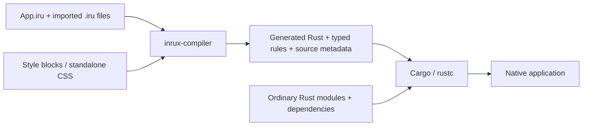
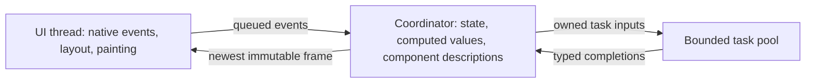

# Architecture and ownership

Inrux owns its public component, styling, state and service contracts. Native engine details remain behind `inrux-adapter` and the selected private binding. The public `inrux` facade re-exports application APIs; the compiler is a separate build dependency.

## Compilation

Custom components must be explicitly imported. The compiler follows the reachable imported graph. Imported candidates used in runtime conditionals remain part of the graph; an unimported custom tag is an error. This is compile-time reachability, not runtime code loading. rustc/linker optimization determines final machine-code retention.

`.iru` styles and optional standalone CSS compilation produce typed Rust rules. Matching uses immutable indexes plus specificity/source-order and viewport/state predicates. Dynamic state still requires runtime evaluation; compiling CSS does not remove all styling/layout work.

## Runtime threads

A coordinator serializes application event/state work. Native objects remain on the UI thread. Expensive blocking work belongs in tasks; callbacks and rendering can still stall their owning thread. Bounded queues, cancellation and mount generations control lifetime and stale completions; they are not a guarantee that the UI can never lag.

The current hosts consume published descriptions and perform shared layout/native translation. Fully incremental layout, persistent native-tree updates and broad cache reuse are still optimization work.

## Adapter boundary

`inrux-adapter` defines startup, window/error types, capability checks and service contracts without GUI engine types. `inrux-egui`, `inrux-masonry` and `inrux-gpui` own native widgets/resources, event translation and painting. Components are written once above this boundary; private native bindings implement the necessary primitives for each engine.

An implementation may delegate a service to a native engine when it satisfies Inrux semantics, or select an existing library/fallback. There must be one layout authority for a subtree, rather than two competing layout passes. All three current bindings select the shared Taffy provider and shared Parley/Swash text provider. Alternative native layout delegation is not delivered yet.

Service contracts need explicit ownership, errors, capabilities, threading and invalidation. Engines do not gain public styling behavior simply because an upstream feature exists; shared behavior must pass conformance checks. See [operational service APIs](ADAPTER-SERVICES.md).

## Styling and text

Applications own themes, tokens, classes and component visual recipes. Framework components supply behavior and minimal defaults that applications can override. The [CSS guide](CSS-ENGINE.md) describes the supported subset; [public parts](STYLING-PARTS.md) expose selected inner surfaces without native handles.

`inrux-text` shapes with Parley, produces shared caret/selection geometry and rasterizes glyph tiles with Swash. Native backends upload these pixels. Fonts register before mounting. Common geometry/pixels reduce cross-engine differences; compositor output, fallback coverage, accessibility and IME still need platform validation. See [text rendering](TEXT-RENDERING.md).

## Backend selection and measurement

The facade has no default GUI engine. Applications enable one engine feature and rebuild to switch compatible code. Backend-native types stay out of application components. Runtime migration of live windows is not supported. Some primitives remain engine-specific; unsupported capabilities must be reported rather than silently ignored.

Benchmark native baselines and framework applications under the same workload. Include translation, allocations/caching, layout count, startup, idle/heavy memory, input latency and frame-time distributions. There is no published overall performance ranking or certified default engine yet. The [status page](STATUS.md) records the main gaps.
